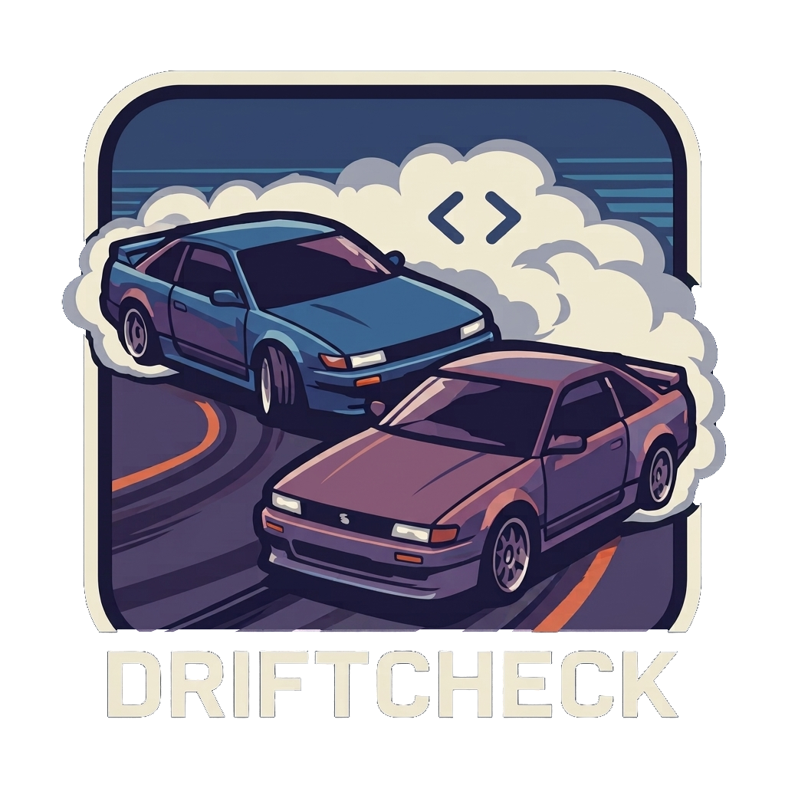

<p align="center"></p>

# driftcheck

[](https://github.com/DavidOlsson/driftcheck/actions/workflows/ci.yml)

**Live example:** [driftcheck's report on the Wikipedia apps' search](https://davidolsson.github.io/driftcheck/) · **Download:** [latest release](https://github.com/DavidOlsson/driftcheck/releases/latest)

Many teams build the same app twice, in Kotlin for Android and in Swift for iOS. Over time the two drift apart: different timeouts, limits, validation, error handling, or a feature that only exists on one side. Nobody notices until a user or a tester does.

driftcheck lets Claude read how one feature is implemented in each app, describe both in the same structure, and report the differences. Every claim comes with a file, line and quote, which is checked against the source code, so the report shows what is verified.

It runs locally through your own [Claude Code](https://claude.com/claude-code) login. No API key is needed, and your code is only sent to Anthropic.

## Install

Needs JDK 17 or newer and [Claude Code](https://claude.com/claude-code), installed and logged in (`claude`).

Download `driftcheck-<version>.zip` from [GitHub Releases](https://github.com/DavidOlsson/driftcheck/releases/latest), unzip it and put its `bin` directory on your `PATH`. Or build it yourself:

```bash
./gradlew installDist    # builds a runnable copy in build/install/driftcheck
build/install/driftcheck/bin/driftcheck --version
```

## Usage

Run it in a directory that contains (or is above) both apps:

```bash
driftcheck init                      # creates .driftcheck/config.json
driftcheck compare search            # describes "search" on both platforms and reports the differences
driftcheck verify .driftcheck/specs/search/android.json   # checks a description's evidence again
driftcheck report search             # rebuilds the report from stored results, without Claude
```

`.driftcheck/config.json` points at the two apps and lists the features to compare:

```json
{
  "version": 1,
  "name": "Wikipedia",
  "platforms": {
    "android": { "path": "android" },
    "ios": { "path": "ios" }
  },
  "features": [
    { "id": "search", "name": "Search", "hints": ["SearchFragment"] }
  ],
  "model": "claude-sonnet-5-5",
  "maxBudgetUsd": 2
}
```

`name` is the app's name, shown at the top of every report. `hints` are optional pointers (class names, folders, screens) that help Claude find the feature faster. Platform paths must lie inside the project unless you pass `--allow-external-paths`.

`compare` makes three Claude runs: one read-only agent per platform, then one run without tools that compares the two descriptions. It writes:

- `.driftcheck/specs/<feature>/{android,ios}.json`: the verified descriptions
- `.driftcheck/findings/<feature>.json`: the findings, with the model and usage of the run
- `.driftcheck/reports/<feature>.html`: the report, one self-contained HTML file that opens in any browser, also offline. It starts with the number of differences, how many are high severity, the questions for the team and how much evidence was verified. Below that, every difference is listed most severe first, filterable by severity and category and searchable by text or file name, with both platforms side by side and every source reference marked as verified or not. What is the same on both platforms and how the run was checked come last.

See [examples/wikipedia-search.html](examples/wikipedia-search.html) (download it and open it in a browser) for a real report on the search feature of the open source Wikipedia apps.

## How the agent is restricted

Each platform is analyzed by `claude -p` with its source root as working directory, and:

- only the `Read`, `Grep` and `Glob` tools, with write, shell, web and agent tools explicitly denied
- `--restricted`, so the analyzed repository's settings, `CLAUDE.md`, skills and agents are never loaded, with `--safe-mode` as a second layer
- `--strict-mcp-config`, `--permission-mode dontAsk` and no session persistence
- no `ANTHROPIC_*` or `CLAUDE_CODE_USE_*` variables, so a run never bills an API key or cloud account and never sends code to another endpoint

The analyzed code is treated as data: prompts say so, and nothing in the repository can change how driftcheck or the agent behaves.

## Evidence, not guesses

Every item in a description cites a file, a line and a short verbatim quote. driftcheck checks each one against the source and marks it `verified`, `line_exists`, `quote_not_found`, `line_out_of_range` or `file_not_found`. Paths are resolved strictly inside the platform root (no absolute paths, `..` or symlinks out of it).

Findings may only cite evidence from the two descriptions, and each reference keeps its checked status. The report marks references that could not be confirmed with ⚠ and flags findings without any source.

## Usage and limits

Runs count toward your Claude plan. Each run is capped by `maxBudgetUsd` (default 2, at most 20), and the report and terminal show how much of your **5-hour window** and **weekly limit** is used, when Claude Code reports it.

## Development

```bash
./gradlew build          # compiles, runs the tests (Claude is never called) and checks the style with ktlint
./gradlew ktlintFormat   # fixes style errors
```

CI runs `./gradlew build` on every pull request. After a merge to main, a new `version` in `build.gradle.kts` is published as a GitHub release with the zip. The [Wikipedia report](https://davidolsson.github.io/driftcheck/) is regenerated by hand with the `Wikipedia report` workflow.

See [`CLAUDE.md`](CLAUDE.md) for the project rules and architecture.

## License

[MIT](LICENSE)
