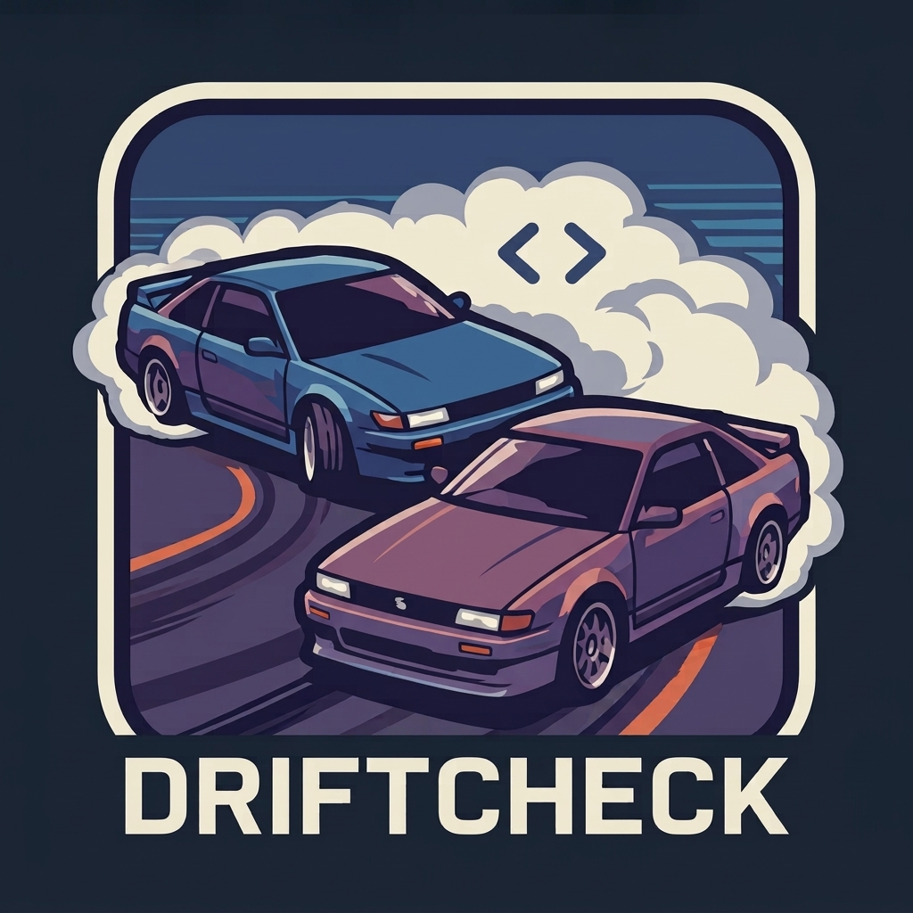

<p align="center"></p>

# driftcheck

Many teams build the same app twice, in Kotlin for Android and in Swift for iOS. Over time the two drift apart: different timeouts, limits, validation, error handling, or a feature that only exists on one side. Nobody notices until a user or a tester does.

driftcheck will let Claude read how one feature is implemented in each app, describe both in the same structure, and report the differences. Every claim comes with a file and line, which is checked against the source code, so the report shows what is verified.

It runs locally through your own [Claude Code](https://claude.com/claude-code) login. No API key is needed, and your code is only sent to Anthropic.

> 🚧 **Under development.** The foundation is in place, but there is no command that compares apps yet.

## Build

Needs JDK 17 or newer. The Gradle wrapper downloads Gradle itself.

```bash
./gradlew build          # compiles and runs the tests
./gradlew installDist    # builds a runnable copy in build/install/driftcheck
build/install/driftcheck/bin/driftcheck --version
```

## License

[MIT](LICENSE)
